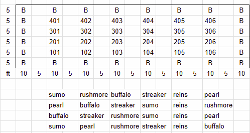
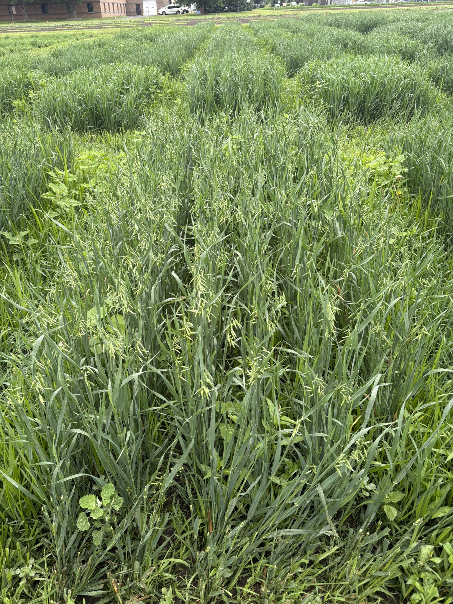
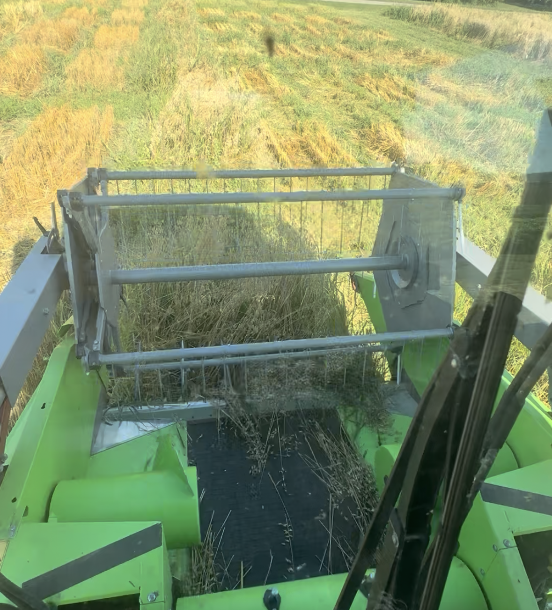
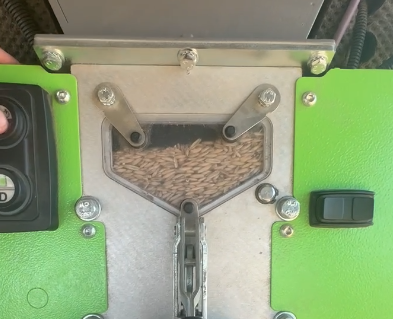

link to data:<https://docs.google.com/spreadsheets/d/1-dI9AvKNXQALnqeG1BHwhA_7TwHpZvqA6yte4kpffxY/edit?gid=71330303#gid=71330303>

\newpage

# Summary

## Narrative

This trial was planted to gain familiarity with the oat/barley lab equipment. Trial was planted in the oat preliminary yield trial area on st paul field F1 on 29Apr2026 using the 10 row almaco drill which seeds 6 rows of a packet and the remaining 4 are winter wheat fill.

We planted 6 row plots which result in 3.5 ft x 12 ft plots, then trimmed them to 3.5 ft x 10 ft. The barley lab cultivated the plots during emergence but did not handweed our variety trial. As a result, the trial got weedy because we did not maintain the trial during the fieldseason. From 22Jun - 22Jul the trial was very weedy. We did one handweeding event right before harvest (July 22) to remove very large weeds (\~2 hrs of work with 3 people). We then combine harvested the plots on August 5th.

## Questions

How do we plant one of these trials?

How do we manage them for weeds?

How do we harvest?

## Findings

Planting: Planting went well. We just need to plant on population rather than weight basis.

Weed management: We need handweeding at least twice in season. Starting in early June when plants get too big to cultivate.

Harvest: Using the combine scale is just as good as weighing in lab. Planting 6 rows in a 10 ft plot will not have enough sample for moisture and test weight at harvest in low yielding plots. Streaker is a hulless oat variety and needs a special correction for comparisons with hulled varieties when comparing yields in bushel per acre across varieties. This correction has not been applied yet.

Yield data: Of 24 plots, only 20 ended up making it to yield analysis due to issues with the data. We averaged around 20 bushels per acre which is very low, we expect around 80 bushels per acre. Moisture at harvest ranged from 10-12.5% which is acceptable.

## photos









## specs

Seed packaged in 2024, 1 gram of seed per sq ft, 45 grams per 3.5 x 12 ft seeded area

Planted 4/29/2026

Harvested 8/5/2026

Combine settings: drum=1540, distance=11mm, blower=3000

## error acknowledgements

Plots not planted on a population basis

Trial very weedy

Sample sizes too small to compute test weight and moisture for all samples (20/24 had test weight) (16/24 had moisture)

# Data QAQC

## Yield HarvestMaster

Yield estimates using combine system (which we trust based on canola data)

Average MN Oat yield is 80 bu A. Over 100 is good, below 70 is low. below 25 is very low.

```{r}
library(tidyverse)

read.csv("master_v_oat_26 - final.csv") -> dat

```

```{r}
dat |> 
  rename(yield_combine32TW_buA = yield_combine32TW..bu.A.,
         yield_combineAdjTW_buA = yield_combineAdjTW..bu.A.,
         yield_hand32TW_buA = yield_hand32TW..bu.A.,
         yield_handAdjTW_buA = yield_handAdjTW..bu.A.)  -> dat


```

```{r}
dat |> 
  arrange(plot) |> 
  glimpse()
```

There are 4 estimates of yield

- yield_combine32TW = yield where weight is collected by combine and test weight is set to 32 lb per bu

- yield_combineAdjTW = yield where weight data is from combine and test weight collected on a perten 5200 is used. Many samples did not have sufficient volume for this calculatoin.

- yield_hand32TW = yield where weight data comes from subsample in combine which should be entire combine sample but may differ and test weight is set to 32

- yield_handAdjTW = yield where weight data comes from subsample in combine and test weight adjusted based on Perten 5200.

```{r}

dat |> 
  filter(variety!="b") |>
  select(plot, notes, testweight_perten5200, moisture_perten5200, yield_combine32TW_buA) 

# 
# dat |> 
#   filter(variety != "b") |> 
#   arrange(moisture_perten5200) |> 
#   select(plot, moisture_perten5200)
```

## Outliers

```{r}

dat |> 
  filter(yield_combine32TW_buA<5) |> 
  select(plot, variety, notes, yield_combine32TW_buA)
```

There are two plots with no yield or negative yield. This is combine error and will be removed

```{r}
dat |> 
  filter(yield_combine32TW_buA>1)-> dat2
```

What about other plots in block 1

```{r}
dat2 |> 
  filter(plot<200) |> 
  select(plot, variety, notes, yield_combine32TW_buA)
```

remainder of block 1 looks fine

```{r}
dat2 |> 
  ggplot(aes(yield_combine32TW_buA)) +
  geom_boxplot()
  
```

What about high yielding plot?

```{r}
dat2 |> 
  filter(yield_combine32TW_buA>50) |> 
  select(plot, variety, yield_combine32TW_buA)
```

It's a border with relatively high yield

```{r}
dat2 |> 
  ggplot(aes(yield_combine32TW_buA)) +
  geom_histogram(bins = 10)
```

- Yields average around 20-30 bushels an acre. This is very low, but normally distributed

<!-- -->

- I wonder if the 70 buA border was just 2 plots combined. I'm going to take out that plot

- The 100s was noted in combine as a messed up pass, it was the 300s and 400s where we started doing well

```{r}
# taking out the 70 bu A plot. I think that a double measurement

dat2 |> 
  filter(yield_combine32TW_buA<70) -> dat2

```

What is up with the 1 bu A plot in the 32TW estimates?

```{r}
dat2 |> 
  filter(yield_combine32TW_buA<8)
  
```

- 32TW plots are lower yielding than AdjTW plots because of the very low test weights

- combine and hand seem to track similarly for AdjTW

- Very low yielding plots unsurprisingly do not have TW data

## Lodging

```{r}
dat2 |> 
  ggplot(aes(lodgingscore_10flat_0erect, yield_combine32TW_buA)) + 
  geom_point()

dat2 |> 
  ggplot(aes(variety, lodgingscore_10flat_0erect)) + 
  geom_boxplot()
```

- Lots of lodging

- Sumo seems to have lower lodging

- No obvious trend between lodging and yield so not really going to investigate further

```{r}
dat2 |> 
  summary()
```

# Statistics

## Using combine weights and assumed TW of 32 lbs bu

```{r}
dat2 |> 
  # group_by(variety) |> 
  summarise(
    # mean = round(mean(yield_combine32TW_buA)),
    mean = round(mean(yield_combineAdjTW_buA, na.rm=T)),
    sd = round(mean(yield_combine32TW_buA)),
    n = n(),
    moisture = round(mean(moisture_perten5200, na.rm=T)), 
    testwegith = round(mean(testweight_perten5200, na.rm=T)))
```

```{r}
library(agricolae)

model_withBorders <- aov(yield_combine32TW_buA~variety, data = dat2)

summary(model_withBorders)
```

- Fail to reject Ho that there are no differences in yield when borders are included

- there are 23 border plots, let's remove them for comparison among the n=4 variety plots

```{r}
dat2 |> 
  filter(variety!="b") -> dat3

model_noBorder <- aov(yield_combine32TW_buA~variety, data = dat3)

summary(model_noBorder)

LSD.test(model_noBorder,
         trt="variety") |> 
  print()
```

- Reject Ho there are differences among varieties

```{r, echo=FALSE}
#| fig-cap: "Oat yields compared across varieties"

## AI solution
library(multcompView)
tukey <- TukeyHSD(model_noBorder)
cld <- multcompLetters4(model_noBorder, tukey)$variety$Letters

df_summary <- dat3 %>%
  group_by(variety) %>%
  summarise(
    mean_val = mean(yield_combine32TW_buA),
    sd_val = sd(yield_combine32TW_buA)
  ) %>%
  mutate(letter = cld[variety]) # Matches letters to the correct group name

df_summary |> 
  mutate(letter = c("a", "a", "a", "a", "b", "a")) -> df_summary


ggplot(df_summary, aes(x = variety, y = mean_val)) +
  geom_errorbar(aes(ymin = mean_val - sd_val, ymax = mean_val + sd_val), 
                width = 0.2, color = "black") +
  # Draw the bars representing the means
  geom_col(fill = "steelblue", width = 0.6,
           col =1) +
  
  # Optional: Add error bars so the letters don't overlap them

  
  # Place the letters above the maximum height (mean + standard deviation)
  geom_text(aes(y = mean_val + sd_val, label = letter), 
            vjust = -0.5, 
            fontface = "bold", 
            size = 5) +
  
  # Add 15% top padding to ensure the text doesn't hit the ceiling
  scale_y_continuous(expand = expansion(mult = c(0, 0.15))) +
  labs(y = "Yield (bu/A)") 

```

## yield_combineAdjTW_buA

```{r}
dat2 |>  
  drop_na(yield_combineAdjTW_buA) -> dat4 

dat4 |> 
  group_by(variety) |>  
  summarise(   
    mean = round(mean(yield_combineAdjTW_buA )), 
    sd = round(mean(yield_combineAdjTW_buA)),   
    n = n() ) 

model_withBorders <- aov(yield_combine32TW_buA~variety, data = dat4)  

summary(model_withBorders)

LSD.test(model_noBorder,
         trt="variety") |> 
  print()
```

```{r}
#| fig-cap: "Oat yields compared across varieties"

## AI solution
tukey <- TukeyHSD(model_noBorder)
cld <- multcompLetters4(model_noBorder, tukey)$variety$Letters

df_summary <- dat4 %>%
  group_by(variety) %>%
  summarise(
    mean_val = mean(yield_combine32TW_buA),
    sd_val = sd(yield_combine32TW_buA)
  ) %>%
  mutate(letter = cld[variety]) # Matches letters to the correct group name

df_summary |> 
  mutate(letter = c("a", "a", "a", "a", "b", "a")) -> df_summary


ggplot(df_summary, aes(x = variety, y = mean_val)) +
  geom_errorbar(aes(ymin = mean_val - sd_val, ymax = mean_val + sd_val), 
                width = 0.2, color = "black") +
  # Draw the bars representing the means
  geom_col(fill = "steelblue", width = 0.6,
           col =1) +
  
  # Optional: Add error bars so the letters don't overlap them
  
  
  # Place the letters above the maximum height (mean + standard deviation)
  geom_text(aes(y = mean_val + sd_val, label = letter), 
            vjust = -0.5, 
            fontface = "bold", 
            size = 5) +
  
  # Add 15% top padding to ensure the text doesn't hit the ceiling
  scale_y_continuous(expand = expansion(mult = c(0, 0.15))) +
  labs(y = "Yield (bu/A)") 

```

## comparison of yield methods

```{r}

data_long <- dat4 %>%
  pivot_longer(
    cols = c(yield_combine32TW_buA,
             yield_combineAdjTW_buA,
             yield_hand32TW_buA,
             yield_handAdjTW_buA), 
    names_to = "Variable", 
    values_to = "Measurement"
  )

```

```{r}
#| fig-cap: overall trend of yield measurements

ggplot(data_long, aes(x = Variable, y = Measurement, fill = Variable)) +
  geom_boxplot(alpha = 0.6, outlier.shape = NA) + # Hide outliers here so they aren't doubled by jitter
  geom_jitter(width = 0.2, alpha = 0.4, color = "black") +
  theme_minimal() +
  labs(
    title = "Comparison of Response Variables",
    x = "",
    y = "Yield (bu/A)"
  ) +
  theme(legend.position = "none",
        axis.text.x = element_text(angle=45, hjust = 1)) # Legend is redundant because x-axis is labeled
```

```{r}

data_long |> 
  filter(plot>400) |> 
  ggplot(aes(x = Variable, y = Measurement, group = plot)) +
  geom_line(alpha = 0.25, color = "slategray") +       # Connects the 4 dots per ID
  geom_point(aes(color = plot), alpha = 0.6, size = 2) + 
  theme_minimal() +
  labs(
    title = "Just block 4",
    x = "Measurement Type",
    y = "Value"
  ) +
  theme(axis.text.x = element_text(angle=45, hjust=1))

```

```{r}
data_long |> 
  filter(plot>300 & plot<400) |> 
  ggplot(aes(x = Variable, y = Measurement, group = plot)) +
  geom_line(alpha = 0.25, color = "slategray") +       # Connects the 4 dots per ID
  geom_point(aes(color = plot), alpha = 0.6, size = 2) + 
  theme_minimal() +
  labs(
    title = "Just block 3",
    x = "Measurement Type",
    y = "Value"
  ) +
  theme(axis.text.x = element_text(angle=45, hjust=1))

```
